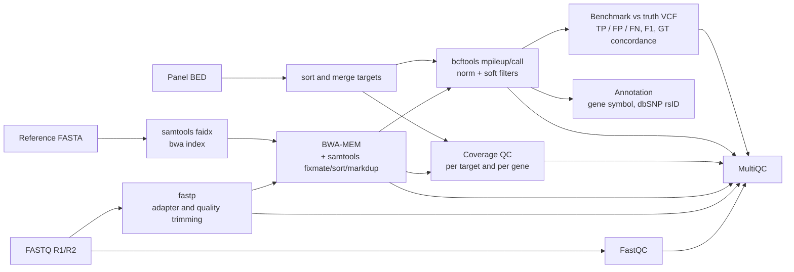
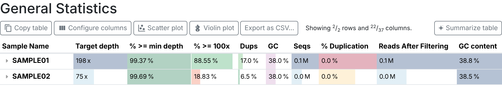
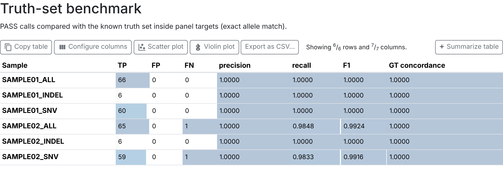

# ngs-germline-panel-nf

[](https://github.com/thaisdolzany/ngs-germline-panel-nf/actions/workflows/ci.yml)


Nextflow DSL2 pipeline for germline SNV and small indel calling in targeted
gene panels (Illumina paired-end). It covers the steps a diagnostic panel
needs before interpretation: read QC, alignment, duplicate marking,
per-target coverage QC, variant calling, annotation and analytical
validation against a known truth set.

The repository ships a small simulated dataset with a known answer, so the
whole workflow runs end to end in a few minutes and reports precision,
recall and genotype concordance on every push.

## Workflow



| Step | Tool | Output |
| --- | --- | --- |
| Read QC | FastQC 0.13.0 | per-read HTML/zip |
| Trimming | fastp 1.3.6 | trimmed FASTQ, JSON/HTML report |
| Alignment and duplicates | BWA-MEM 0.7.19, samtools 1.22.1 | `*.md.bam`, flagstat, samtools stats, markdup stats |
| Coverage QC | samtools 1.24 | depth per target and per gene, list of targets below `--min_depth` |
| Variant calling | bcftools 1.23.1 | VCF with `PASS` / `LowQual` soft filters, bcftools stats |
| Annotation | bcftools 1.23.1 | VCF with `INFO/GENE` and rsID, flat TSV for review |
| Benchmark | bcftools 1.23.1 | precision, recall, F1 and genotype concordance by variant type |
| Report | MultiQC 1.35 | single HTML report for the run |

Each process uses the same container images and Bioconda versions as the
corresponding [nf-core/modules](https://github.com/nf-core/modules), so the
software environment is pinned and reproducible.

## Quick start

Requirements: Nextflow 24.10 or later and one of Docker, Singularity/Apptainer
or Conda. On Windows, run it inside WSL2.

```bash
nextflow run thaisdolzany/ngs-germline-panel-nf -profile test,docker
```

The `test` profile downloads GRCh38 chr21 and a chr21 dbSNP subset from
[nf-core/test-datasets](https://github.com/nf-core/test-datasets) and runs
the two simulated samples in `assets/test`. Results go to `results/`.

To run your own data:

```bash
nextflow run thaisdolzany/ngs-germline-panel-nf -profile docker \
    --input samplesheet.csv \
    --fasta GRCh38.fasta \
    --targets my_panel.bed \
    --dbsnp dbsnp.vcf.gz \
    --outdir results
```

### Samplesheet

```csv
sample,fastq_1,fastq_2,truth_vcf
SAMPLE01,reads/S1_R1.fastq.gz,reads/S1_R2.fastq.gz,truth/S1.vcf.gz
SAMPLE02,reads/S2_R1.fastq.gz,reads/S2_R2.fastq.gz,
```

`truth_vcf` is optional. When it is filled in (for example with a GIAB
reference sample), that sample is benchmarked. Relative paths are resolved
against the folder that contains the samplesheet.

### Parameters

| Parameter | Default | Description |
| --- | --- | --- |
| `--input` | required | samplesheet CSV |
| `--fasta` | required | reference FASTA; the bwa index is built by the pipeline |
| `--targets` | required | panel BED (column 4 = gene symbol); overlapping intervals are merged |
| `--dbsnp` / `--dbsnp_tbi` | none | bgzipped, indexed dbSNP VCF used to fill the ID column; `--dbsnp false` turns it off |
| `--min_depth` | 20 | per-base depth used to flag under-covered targets |
| `--min_qual` | 30 | calls with QUAL below this are marked `LowQual` |
| `--min_variant_depth` | 10 | calls with FORMAT/DP below this are marked `LowQual` |
| `--outdir` | `results` | output folder |

Resources per process are capped at 4 CPUs and 8 GB (`process.resourceLimits` in
`conf/base.config`). Change the caps with a custom config passed through `-c`.

## Outputs

```
results/
├── alignment/            SAMPLE.md.bam, .bai
├── benchmark/            SAMPLE.benchmark.tsv, SAMPLE.discordant.tsv
├── multiqc/              multiqc_report.html
├── pipeline_info/        software_versions.yml, execution report, timeline, trace
├── qc/
│   ├── alignment/        flagstat, samtools stats, markdup stats
│   ├── coverage/         per-target and per-gene depth, low_coverage.bed
│   ├── fastp/
│   └── fastqc/
├── reference/            targets.bed (sorted and merged)
├── summary/              run-level tables: benchmark, coverage per gene, all variants
└── variants/
    ├── raw/              SAMPLE.vcf.gz with soft filters, bcftools stats
    └── annotated/        SAMPLE.annotated.vcf.gz, SAMPLE.variants.tsv
```

`*.variants.tsv` has one line per call with gene, rsID, QUAL, filter,
genotype, depth and allele depths, which is the table a reviewer opens
first. `low_coverage.bed` lists the targets with at least one base below
`--min_depth`; in a diagnostic report these are the regions that cannot be
called negative.

Coverage QC applies the same filters as the caller: MAPQ ≥ 20, base quality
≥ 20, duplicates and secondary alignments removed, and overlapping mates of
the same fragment counted once.

## Test dataset and validation

**Panel.** Coding exons (MANE Select CDS, padded by 20 bp to include splice
sites) of nine genes on GRCh38 chr21: APP, ADAMTS1, BACH1, CCT8, CXADR, JAM2,
LTN1, NCAM2 and NRIP1. That is 112 targets and 26,815 bp. The genes were
chosen because they are covered by the chr21 GENCODE subset in
nf-core/test-datasets; the panel exists to exercise the pipeline, not as a
clinical panel. `dev/make_panel_bed.py` builds it from the GTF.

**Truth set.** For each sample, 60 SNVs and 6 indels were drawn from real
population catalogues (1000 Genomes phase 1 SNPs and Mills/1000G indels)
that fall inside the targets, and each received a genotype (0/1 or 1/1).

**Reads.** `dev/simulate_panel_reads.py` builds the two haplotypes of each
target region and samples 2 x 150 bp read pairs with a base error model.
Capture efficiency varies between regions, and each region has a 3% chance
of being simulated at very low depth to mimic a capture dropout. SAMPLE01 was
simulated at roughly 200x on target and SAMPLE02 at roughly 75x. The script
uses only the Python standard library and a fixed seed, so the data can be
regenerated exactly (see `dev/README.md`).

### Results on the test dataset

| Sample | Mean target depth | Targets ≥ 20x (% bases) | SNV recall | Indel recall | Precision | GT concordance |
| --- | --- | --- | --- | --- | --- | --- |
| SAMPLE01 | 198x | 99.37 | 60/60 | 6/6 | 66/66 | 66/66 |
| SAMPLE02 | 75x | 99.69 | 59/60 | 6/6 | 65/65 | 65/65 |

Precision is the fraction of `PASS` calls inside the targets that are in the
truth set. Genotype concordance is the fraction of true positives whose
genotype (0/1 or 1/1) matches the truth.

The truth set is small, so the estimates are wide. Pooling both samples,
SNV recall is 119/120 (95% CI 95.4 to 100%, Clopper-Pearson) and indel recall
is 12/12 (95% CI 73.5 to 100%). Twelve indels are enough to show that the
indel path works, not to establish indel sensitivity.

Full tables are in [`docs/example_results`](docs/example_results). They come
from the `test` profile run with Nextflow 26.10.2 and 24.10.0 (identical
output), using the same tools built from source instead of containers. The CI
job reruns the pipeline with the pinned containers on every push and fails if
F1 for any sample drops below 0.95.



FastQC reports 17% sequence duplication for SAMPLE01. That is expected when
a 27 kb target is sequenced at about 200x, because independent fragments
often start at the same position. Duplicates marked by position and
orientation with `samtools markdup` are 0.39% for SAMPLE01 and 0.16% for
SAMPLE02.



### What the validation caught

**Indels silently skipped at high depth.** With the bcftools default
settings, SAMPLE01 loses one of its six indels (indel recall 0.83) while
SAMPLE02, at lower depth, recovers all of them. The missed deletion sits at
a site with close to 500x raw depth. `bcftools mpileup` skips indel calling
when the per-file depth exceeds `--max-idepth`, which defaults to 250. Gene
panels are usually sequenced well above that, so the pipeline sets the limit
to 5000 in `modules/local/call_variants.nf`, and SAMPLE01 indel recall is
6/6. Without a truth set the default would look like a clean run.

**The one false negative is explained by coverage QC.** SAMPLE02 misses
chr21:17513186 A>C in CXADR. The variant was called (QUAL 91) but carries
the `LowQual` filter because only 9 reads cover it. The whole target sits in
a simulated capture dropout (mean depth 8x) and is listed in
`SAMPLE02.low_coverage.bed`. This is the expected behaviour: the region is
reported as not evaluable instead of as negative.

**Low-coverage flags are not always capture failures.** SAMPLE01 has two
flagged targets. One, in NCAM2, is a simulated dropout (mean depth 16x) with
no truth variant inside it, so it does not affect recall but would still be
reported as not evaluable. The other, in CCT8, is flagged because four
bases fall below 20x. Those are the bases removed by a homozygous 4 bp
deletion (chr21:29066782 TAAGA>T), so reads cannot cover them. Reading
`low_coverage.bed` next to the calls separates real dropouts from this case.

## Design choices and limitations

- **Caller.** bcftools is fast, light and easy to run in CI. Production
  diagnostic pipelines more often use GATK HaplotypeCaller or DeepVariant,
  which reassemble haplotypes and handle complex indels better. The calling
  step is isolated in one module so it can be swapped.
- **Benchmark.** Matching is exact on CHROM, POS, REF and ALT after
  splitting multiallelic records and left-normalising. Different
  representations of the same complex variant are not reconciled; hap.py or
  rtg vcfeval do that and should be used with GIAB samples.
- **Simulated data.** The simulator reproduces depth variation, dropouts
  and random sequencing errors. It does not reproduce GC bias, PCR
  artefacts, mapping problems in segmental duplications or systematic
  errors, so the metrics above are an upper bound and do not replace
  validation with reference materials.
- **Ploidy.** Every site is called as diploid. That is correct for this
  chr21 test, but a panel with genes on chrX or chrY needs sex-aware ploidy
  (`bcftools call --ploidy` with a samples file).
- **Scope.** Small variants only. No CNV calling, no mitochondrial
  analysis, no ACMG classification. Annotation is limited to gene symbol
  and rsID; consequence and population frequency would need VEP or snpEff
  plus gnomAD.
- **Not for clinical use.** This is a portfolio project. A clinical
  pipeline also needs validated reference samples, change control and
  documentation required by the laboratory's quality system.

## Possible extensions

- GATK HaplotypeCaller or DeepVariant as an alternative caller
- hap.py benchmark on a GIAB sample (HG001/HG002) restricted to the panel
- VEP annotation with gnomAD and ClinVar
- CNV detection from target depth (for example with CNVkit)
- nf-test unit tests per module

## Repository layout

```
main.nf                 workflow
nextflow.config         parameters and profiles
conf/                   resources, publishing rules, test profile
modules/local/          one file per process
bin/                    coverage_qc.sh, benchmark_vcf.sh (added to PATH by Nextflow)
assets/                 test samplesheet, demo panel BED, test reads and truth VCFs, MultiQC config
dev/                    scripts that built the test panel and the simulated reads
docs/                   example results and report screenshots
.github/workflows/      CI
```

## Software and data

- Nextflow: Di Tommaso et al., *Nature Biotechnology* 35, 316 (2017). doi:10.1038/nbt.3820
- BWA-MEM: Li, arXiv:1303.3997 (2013)
- SAMtools and BCFtools: Danecek et al., *GigaScience* 10, giab008 (2021). doi:10.1093/gigascience/giab008
- fastp: Chen et al., *Bioinformatics* 34, i884 (2018). doi:10.1093/bioinformatics/bty560
- MultiQC: Ewels et al., *Bioinformatics* 32, 3047 (2016). doi:10.1093/bioinformatics/btw354
- FastQC: Andrews, Babraham Bioinformatics, https://www.bioinformatics.babraham.ac.uk/projects/fastqc/
- MANE Select transcripts: Morales et al., *Nature* 604, 310 (2022). doi:10.1038/s41586-022-04558-8
- 1000 Genomes phase 1: The 1000 Genomes Project Consortium, *Nature* 491, 56 (2012). doi:10.1038/nature11632
- Mills indels: Mills et al., *Genome Research* 21, 830 (2011). doi:10.1101/gr.115907.110
- Reference, GENCODE annotation and population VCFs used in the test: [nf-core/test-datasets](https://github.com/nf-core/test-datasets)

## Author

Thaís Dolzany de Oliveira, pharmacist, PhD in Biochemistry
[LinkedIn](https://www.linkedin.com/in/thaisdolzany) · [GitHub](https://github.com/thaisdolzany)

## License

MIT
